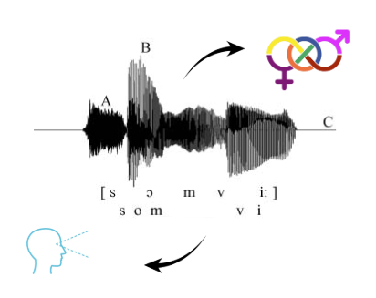

I'm a student at Yale University thinking of majoring in any of Math, CS, and linguistics. I like writing, I like cats, and I like learning. As of recent, I've been motivated by AI safety.

Check out my <a href="/about">about me</a>, <a href="/projects">projects</a>, or some of my <a href="/posts">posts</a>.

<!-- Recent posts as a standalone section -->
<h2>Recent Posts</h2>
<ul class="custom-post-list" style="padding-left: 0;">
  
    
    <li style="margin-bottom: 8px;">
      
      

        <a href="{{ post.url | relative_url }}"><strong>{{ post.title }}</strong></a>
      

    </li>
  
</ul>

<h2>A Recent Project</h2>

  
  <h2 class="project-title">
    <a href="https://jinfanhu.com/projects/gay-voice">A Neural Network Informed Study on the Gay Voice</a>
  </h2>
  
An ongoing project with CUNY Queens on identifying linguistic features that correspond with both self-reported sexuality and listener-perceived sexuality in Gen Z youth.

